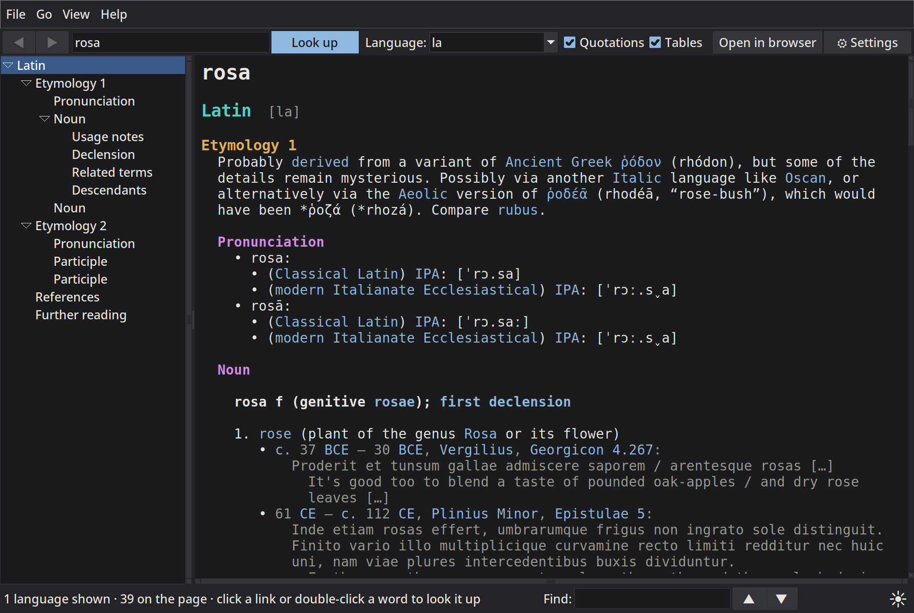
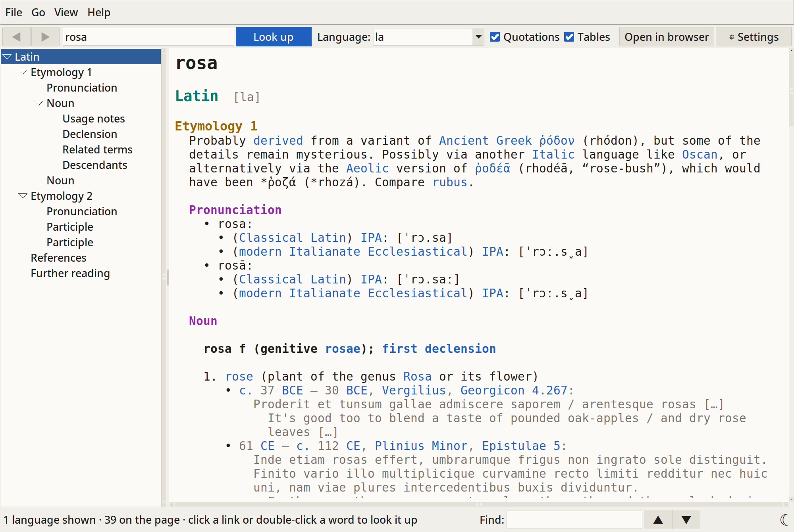
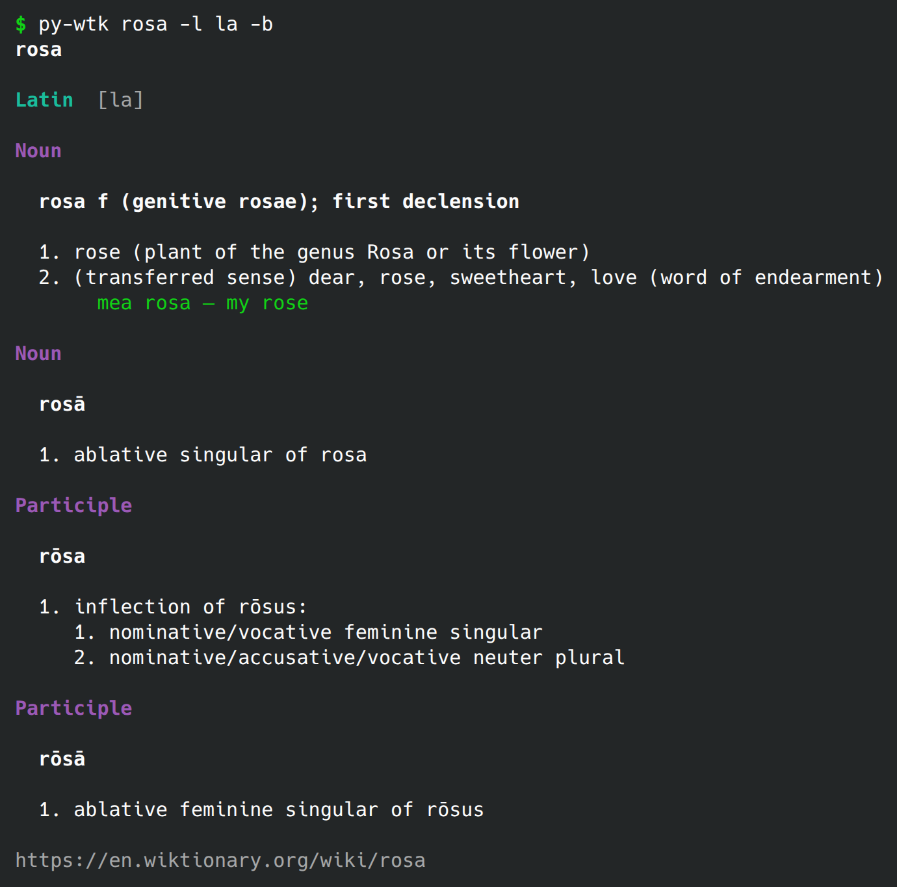
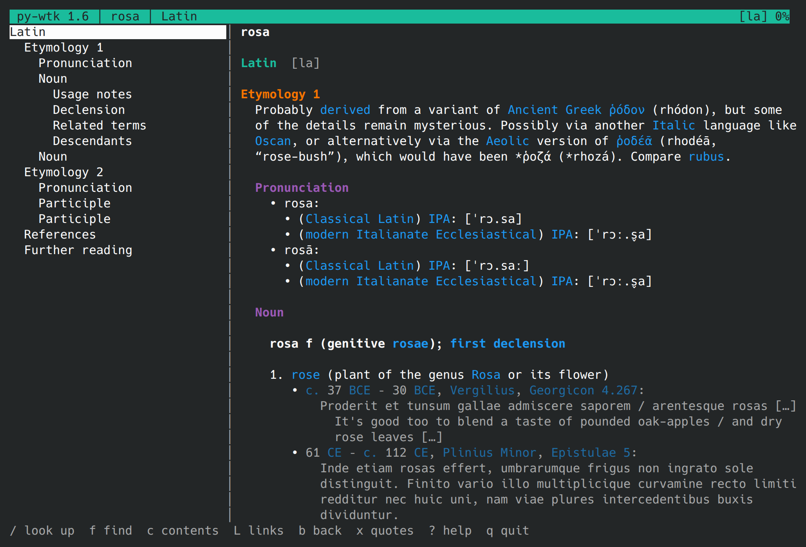

# py-wtk

*[Read in English](README.md)*

py-wtk es un pequeño programa para consultar el [Wiktionary en inglés](https://en.wiktionary.org)
sin abrir el navegador. Viene en tres versiones, que comparten el mismo código por dentro:

| Programa     | Qué es                                                       |
|--------------|--------------------------------------------------------------|
| `py-wtk`     | herramienta de línea de comandos; imprime la entrada en la terminal |
| `py-wtk-tui` | interfaz de terminal a pantalla completa (curses)            |
| `py-wtk-gui` | ventana de escritorio (Tkinter)                              |

Muestra la entrada completa, no solo las definiciones: etimología, pronunciación,
definiciones con ejemplos y citas, notas de uso, tablas de flexión (declinaciones,
conjugaciones), sinónimos, términos derivados y relacionados, descendientes, traducciones,
referencias y lecturas adicionales. Por defecto muestra **todas las lenguas** de la página,
pero se pueden elegir solo las que interesan; por ejemplo, solo latín, o latín y español.

Lo escribí yo, Nicolás Vaughan (<nivaca@fastmail.com> y <n.vaughan@uniandes.edu.co>), en
2026.

[Nicolas Vaughan](https://artehum.uniandes.edu.co/profesores/nicolas-vaughan/) es profesor
asociado de Literatura de la Facultad de Artes y Humanidades de la Universidad de los Andes,
Bogotá, Colombia.

## Capturas de pantalla

Esta es la misma palabra, *rosa* (solo su entrada latina, con `-l la`), en la ventana
(`py-wtk-gui`, aquí en modo oscuro):



la ventana en modo claro:



en la línea de comandos (`py-wtk`, aquí en modo breve, con `-b`):



y en la terminal, a pantalla completa (`py-wtk-tui`):



Estas cuatro imágenes las genera `python3 tools/screenshots.py`, que ejecuta cada programa
sin mostrarlo, con ajustes propios, y las guarda en `docs/img/` (véase
[Para desarrolladores](#para-desarrolladores)). La interfaz de los programas está en inglés.

## Requisitos

- Python 3.11 o posterior (usa `tomllib` para leer los ajustes). Se ha probado con
  Python 3.11 y 3.15.
- Nada más para `py-wtk` y `py-wtk-tui`: solo se usa la biblioteca estándar, no hay que
  instalar paquetes con pip.
- Para `py-wtk-gui` hace falta Tkinter. En muchas distribuciones de Linux viene en un
  paquete aparte: `python3-tkinter` en Fedora, `python3-tk` en Debian y Ubuntu.
- Y, claro, conexión a Internet.

## Instalación

**Lo más fácil, en Linux:** descarga el AppImage de la última versión
(`py-wtk-v.VERSIÓN-x86_64.AppImage`), hazlo ejecutable y ejecútalo. Lleva su propio Python,
así que no hace falta instalar nada:

```sh
chmod +x py-wtk-v.*-x86_64.AppImage
./py-wtk-v.*-x86_64.AppImage            # la ventana
./py-wtk-v.*-x86_64.AppImage cli rosa   # la línea de comandos (también: tui; help los lista)
```

Un enlace al AppImage llamado `py-wtk`, `py-wtk-tui` o `py-wtk-gui` abre ese programa.

**En Fedora:** instala el paquete RPM, que usa el Python y el Tk del sistema y añade los tres
programas al `PATH` y al menú de aplicaciones, con su icono. Lo más fácil es desde
[Copr](https://copr.fedorainfracloud.org/coprs/nivaca/py-wtk/), así `dnf upgrade` trae cada
versión nueva:

```sh
sudo dnf copr enable nivaca/py-wtk
sudo dnf install py-wtk
```

Las versiones publicadas traen también el RPM (`py-wtk-VERSIÓN-1.fcNN.noarch.rpm`), firmado,
con su clave pública (`RPM-GPG-KEY-py-wtk`, que se importa una vez):
`sudo rpm --import RPM-GPG-KEY-py-wtk` y luego `sudo dnf install ./py-wtk-*.noarch.rpm`.
Funciona en cualquier Fedora con Python 3.11 o posterior, sea cual sea el número `fc`. O
genéralo desde la carpeta del programa (un clon de git):

```sh
sudo dnf install rpm-build python3-devel desktop-file-utils python3-tkinter
packaging/build-rpm.sh
sudo dnf install build/rpm/RPMS/noarch/py-wtk-*.rpm
```

El programa se instala en `/usr/share/py-wtk`, con enlaces en `/usr/bin`.

**Con tu propio Python** (cualquier sistema): descarga el zip de la última versión
(`py-wtk-v.VERSIÓN.zip`) o clona el repositorio, pon la carpeta donde prefieras y crea
enlaces a los tres lanzadores en un directorio que esté en tu `PATH`:

```sh
ln -s ~/py-wtk/py-wtk      ~/.local/bin/
ln -s ~/py-wtk/py-wtk-tui  ~/.local/bin/
ln -s ~/py-wtk/py-wtk-gui  ~/.local/bin/
```

Los lanzadores encuentran el paquete `pywtk` que está a su lado, incluso cuando se los llama
a través de un enlace. También se puede ejecutar la herramienta de línea de comandos con
`python3 -m pywtk PALABRA` desde dentro de la carpeta.

**En el menú de aplicaciones:** `py-wtk-install.py` añade la ventana, la versión de terminal
y la línea de comandos (`py-wtk (GUI)`, `py-wtk (TUI)` y `py-wtk (CLI)`, esta última con
`-i`, que pide una palabra tras otra), con su icono, al menú de aplicaciones en Linux, al
menú Inicio en Windows o a `~/Applications` en macOS. Solo escribe en tus propias carpetas,
así que no hacen falta permisos de administrador:

```sh
python3 py-wtk-install.py               # añadirlas
python3 py-wtk-install.py --only-gui    # añadir solo la ventana
python3 py-wtk-install.py --uninstall   # quitarlas
```

Con `--only-gui`, si una ejecución anterior añadió la versión de terminal y la línea de
comandos, sus entradas se quitan.

Las entradas abren el programa desde su carpeta; si mueves la carpeta, vuelve a ejecutarlo.

## Línea de comandos: `py-wtk`

```sh
py-wtk rosa                       # entrada completa, todas las lenguas
py-wtk rosa -l la                 # solo latín
py-wtk rosa -l Latin              # lo mismo, con el nombre (en inglés) de la lengua
py-wtk rosa -l la,es,it           # varias lenguas
py-wtk rosa -b                    # breve: solo las definiciones
py-wtk rosa -l la -o etymology    # solo algunas secciones
py-wtk house -x translations,quotations,tables   # ocultar algunas secciones
py-wtk hablar -l es -o conjugation
py-wtk ice cream                  # expresiones de varias palabras, sin comillas
py-wtk -s recei                   # buscar títulos de páginas
py-wtk house --json               # JSON estructurado, para usar desde otros programas
py-wtk -i                         # pide una palabra tras otra (también: rosa -l la)
```

Opciones:

| Opción                  | Significado                                                      |
|----------------------------|------------------------------------------------------------------|
| `-l`, `--lang`          | lenguas, por código (`la`, `grc`) o por nombre en inglés (`Latin`); por defecto `all` |
| `-o`, `--only`          | mostrar solo estas secciones (separadas por comas)               |
| `-x`, `--exclude`       | ocultar estas secciones; también acepta `quotations` y `tables`  |
| `-b`, `--brief`         | solo las definiciones, sin etimología, citas, tablas…            |
| `-s`, `--search`        | buscar títulos de páginas en lugar de mostrar una entrada        |
| `-F`, `--full`          | entrada completa, aunque esté activado el ajuste `cli.brief`     |
| `-n`, `--limit`         | cuántos resultados da `--search` (10 por defecto)                |
| `-i`, `--interactive`   | después, pedir más palabras, una por línea, con opciones si se quiere; `Ctrl-D` termina |
| `--json`                | salida en JSON                                                   |
| `--no-color`            | sin colores (también se respeta la variable `NO_COLOR`)          |
| `--no-pager`            | no usar `less` para las entradas largas                          |
| `--refresh`             | volver a descargar la página sin usar la caché en disco          |

Opciones para los ajustes (véase [Ajustes](#ajustes) más abajo): `--settings`,
`--configure`, `--set`, `--unset`, `--edit-settings` y `--clear-cache`.

Los nombres de las secciones son los del Wiktionary, en inglés (`etymology`,
`pronunciation`, `noun`, `declension`, `translations`…), y se comparan sin tener en cuenta
mayúsculas ni números, de modo que `etymology` coincide con "Etymology 1" y "Etymology 2".
Si la palabra no existe, el programa propone palabras parecidas. Si la entrada no cabe en la
pantalla, se abre en `less` (o en tu `$PAGER`).

Los enlaces de la entrada son hipervínculos: en los terminales que los admiten (casi todos
los modernos, y `less`) se puede hacer clic en ellos, normalmente con `Ctrl` pulsado. Otros
paginadores (como `most` o `more`) no pueden mostrarlos, así que en ellos la entrada se
muestra sin enlaces. Si tu terminal los muestra como caracteres extraños, desactiva el
ajuste `cli.links`.

El código de salida es `0` si todo va bien, `1` si no se encontró nada y `2` si hubo un
error de red.

## Interfaz de terminal: `py-wtk-tui`

```sh
py-wtk-tui            # empieza con la pantalla vacía; pulsa / para buscar
py-wtk-tui rosa       # abre directamente la palabra
py-wtk-tui rosa -l la
```

A la izquierda hay un índice con las lenguas y las secciones; a la derecha, la entrada.
Teclas principales (pulsa `?` dentro del programa para ver la lista completa):

| Tecla                | Acción                                          |
|----------------------|-------------------------------------------------|
| `/`                  | buscar una palabra (en el campo, `Tab` muestra sugerencias) |
| `j` `k`, flechas     | desplazarse                                     |
| `Espacio`, `AvPág` `RePág` | avanzar / retroceder una página           |
| `[` `]`              | sección anterior / siguiente                    |
| `{` `}`              | lengua anterior / siguiente                     |
| `c` o `Tab`          | ir al panel del índice                          |
| `t`                  | mostrar / ocultar el índice                     |
| `f`, `n` `N`         | buscar en la página, coincidencia siguiente / anterior |
| `l`                  | cambiar las lenguas                             |
| `b` `B`              | atrás / adelante en el historial                |
| `L`                  | lista de los enlaces de la pantalla, para abrir uno |
| `x` `T`              | mostrar / ocultar citas y tablas                |
| `o`                  | abrir la página en el navegador                 |
| `y` o `F7`           | copiar toda la entrada, como texto simple       |
| `S`                  | ajustes                                         |
| `q`                  | salir                                           |

También funciona la rueda del ratón, y se puede hacer clic en el índice y en los enlaces
(en azul). Los enlaces a otras entradas se abren en el programa, al principio de la
entrada; los demás (Wikipedia, los apéndices del Wiktionary, otros diccionarios…), en el
navegador.

`y` copia la entrada con el programa del sistema para el portapapeles (`wl-copy` en Wayland,
`xclip` o `xsel` en X11, `pbcopy` en macOS, `clip` en Windows); si no hay ninguno, le pide
a la terminal que lo haga (OSC 52, también dentro de tmux si este lo permite), cosa que
hacen muchas terminales.

## Ventana de escritorio: `py-wtk-gui`

```sh
py-wtk-gui
py-wtk-gui rosa -l la
py-wtk-gui rosa --dark --size 13       # oscuro y más grande solo esta vez (también existe --light)
```

- Cuadro de búsqueda con sugerencias mientras escribes (flecha abajo para elegir una).
- **Clic en un enlace para abrirlo.** Los enlaces a otras entradas se abren en la
  ventana, al principio de la entrada y con las lenguas del filtro; los demás
  (Wikipedia, los apéndices del Wiktionary, otros diccionarios…), en el navegador. La
  barra de estado dice adónde lleva cada enlace.
- **Doble clic en cualquier palabra de la entrada para buscarla.** El botón derecho abre un
  menú con «Look up», «Copy» y «Select all».
- Un menú *Edit* con Cut, Copy y Paste (cortar, copiar y pegar: `Ctrl+X`, `Ctrl+C`,
  `Ctrl+V`): actúan sobre el cuadro de búsqueda, el de las lenguas y el de buscar en la
  página, y Copy también sobre el texto seleccionado en la entrada. Lo que no se puede
  hacer en ese momento aparece en gris.
- Índice en árbol: haz clic en una sección para ir a ella; se actualiza al desplazarte.
- Selector con las lenguas de la página actual; también se puede escribir `en,la`.
- Casillas para mostrar u ocultar las citas y las tablas.
- Búsqueda en la página (`Ctrl+F`, después `F3` / `Mayús+F3`), con todas las coincidencias
  resaltadas.
- Atrás y adelante (`Alt+←`, `Alt+→`), recargar (`F5`), abrir en el navegador.
- Modo claro y oscuro para toda la ventana: la luna ☾ abajo a la derecha la oscurece y el
  sol ☀ la vuelve clara (también *View → Dark mode*). La elección se recuerda.
- Texto más grande o más pequeño con `Ctrl++` y `Ctrl+-` (todo el texto de la ventana, no
  solo la entrada), y `Ctrl+0` para el tamaño habitual.
- Ventana de ajustes (`Ctrl+,`, el botón «⚙ Settings» o *File → Settings…*).
- Las páginas se cargan en segundo plano, así que la ventana no se congela.

La interfaz del programa está en inglés. El texto usa una fuente monoespaciada para que las
tablas de declinaciones y conjugaciones queden bien alineadas.

## Ajustes

Los tres programas comparten un único archivo de ajustes, `config.toml`, en la carpeta de
configuración habitual del sistema:

| Sistema | Archivo                                                |
|---------|--------------------------------------------------------|
| Linux   | `~/.config/py-wtk/config.toml` (o `$XDG_CONFIG_HOME/py-wtk/`) |
| macOS   | `~/Library/Application Support/py-wtk/config.toml`     |
| Windows | `%APPDATA%\py-wtk\config.toml`                         |

Con la variable `PY_WTK_CONFIG` se puede indicar otra carpeta. El archivo es
[TOML](https://toml.io) y está dividido en secciones: `[general]`, `[cli]`, `[tui]`,
`[gui]`, `[fonts]` y `[appearance]`. Cualquier ajuste se puede omitir, y entonces tiene su
valor habitual; en el archivo, los omitidos aparecen comentados con su valor habitual, y
cada ajuste lleva un comentario que lo explica, así que también se puede editar a mano. Si
algún valor no es válido, el programa lo avisa y usa el habitual.

Los programas escriben en el archivo solo los ajustes que cambias, sobre el archivo tal como
esté en ese momento: si la ventana y la interfaz de terminal están abiertas a la vez, una no
deshace los cambios de la otra. Restablecer el valor habitual de un ajuste lo quita del
archivo. Al reescribirlo no se conservan los comentarios propios.

(Las versiones anteriores se llamaban **py-wkt**. Si las usabas, sus ajustes pasan una vez
a la carpeta nueva: el `config.toml` de `~/.config/py-wkt/`, o su `settings.ini` más
antiguo; el archivo antiguo se renombra `*.old`. La variable `PY_WKT_CONFIG` se sigue
leyendo.)

Qué se puede cambiar:

| Ajuste                          | Por defecto | Qué hace                                     |
|---------------------------------|-------------|----------------------------------------------|
| `general.languages`             | `all`   | lenguas que se muestran si no se indica `-l`     |
| `general.preferred_languages`   | (vacío) | estas lenguas van primero, p. ej. `la, en`       |
| `general.show_quotations`       | `true`  | las citas fechadas bajo las definiciones         |
| `general.show_tables`           | `true`  | tablas de declinación y conjugación              |
| `general.show_translations`     | `true`  | las traducciones (en las entradas grandes son largas) |
| `general.hidden_sections`       | (vacío) | secciones que nunca se muestran, p. ej. `anagrams, references` |
| `general.search_results`        | `10`    | número de resultados y sugerencias               |
| `general.max_width`             | `110`   | anchura máxima del texto, en caracteres          |
| `general.cache_days`            | `1`     | días que se guardan en disco las páginas descargadas (0 = sin caché) |
| `cli.color`                     | `auto`  | `auto`, `always` o `never`                       |
| `cli.pager`                     | `auto`  | `auto`, `always` o `never`                       |
| `cli.pager_command`             | (vacío) | paginador que se usa en lugar de `$PAGER` / `less` |
| `cli.links`                     | `true`  | enlaces en los que se puede hacer clic, en los terminales que lo admiten |
| `cli.brief`                     | `false` | modo breve siempre (entonces `-F` da la entrada completa) |
| `tui.show_contents`             | `true`  | el panel del índice                              |
| `tui.contents_width`            | `30`    | su anchura, en columnas                          |
| `tui.colors`                    | `true`  | colores en la interfaz de terminal               |
| `tui.mouse`                     | `true`  | uso del ratón; desactívalo para seleccionar texto como siempre |
| `tui.wheel_lines`               | `3`     | líneas por cada paso de la rueda                 |
| `gui.show_contents`             | `true`  | el panel del índice                              |
| `gui.contents_width`            | `250`   | su anchura, en píxeles                           |
| `gui.double_click_lookup`       | `true`  | el doble clic en una palabra la busca            |
| `gui.links`                     | `true`  | se puede hacer clic en los enlaces de la entrada |
| `gui.live_suggestions`          | `true`  | sugerencias mientras se escribe                  |
| `gui.remember_window`           | `true`  | abrir la ventana con el último tamaño            |
| `fonts.text_family`             | (vacío) | fuente de las entradas (mejor de ancho fijo); vacío = la habitual |
| `fonts.text_size`               | `11`    | tamaño de las entradas                           |
| `fonts.ui_family`               | (vacío) | fuente del resto de la ventana; vacío = la del sistema |
| `fonts.ui_size`                 | `0`     | su tamaño; `0` = el del sistema                  |
| `appearance.dark_mode`          | `false` | ventana oscura (si se omite: clara)              |

Formas de cambiarlos:

- **Línea de comandos:**
  ```sh
  py-wtk --settings                         # listarlos todos, con sus valores actuales
  py-wtk --configure                        # pequeño menú interactivo
  py-wtk --set general.languages=la,en      # cambiar uno (se puede repetir)
  py-wtk --set preferred_languages=la       # la sección se puede omitir si no es ambigua
  py-wtk --unset general.languages          # volver al valor por defecto
  py-wtk --edit-settings                    # abrir el archivo en $VISUAL / $EDITOR
  py-wtk --clear-cache                      # borrar las páginas guardadas en disco
  ```
- **Interfaz de terminal:** pulsa `S`. Enter cambia el ajuste seleccionado (los de sí/no y
  los de opciones cambian directamente; los demás piden el valor), `d` restablece el valor
  por defecto y `Esc` cierra. Los cambios se guardan al momento.
- **Ventana:** *File → Settings…* (`Ctrl+,`, o el botón «⚙ Settings»). Las pestañas son
  Appearance (modo oscuro y fuentes, con la lista de fuentes de ancho fijo instaladas y una
  vista previa), Window, General (con un botón para vaciar la caché en disco), Terminal UI
  y Command line.

Algunas cosas se recuerdan solas: en la TUI y en la GUI se guarda si se muestran u ocultan
las citas, las tablas o el índice; en la GUI, además, el modo oscuro, el tamaño del texto
(en `[fonts]` solo se escribe lo que difiere de lo habitual), la anchura del índice y el
tamaño de la ventana.

## Cómo funciona

El programa descarga la página en HTML desde la API REST del Wiktionary
(`/api/rest_v1/page/html/…`) y la convierte en texto. Para ello solo usa la biblioteca
estándar de Python (`urllib`, `html.parser`, `textwrap`, `curses`, `tkinter`). Las entradas
grandes, como *house*, tienen las traducciones en una página aparte (`house/translations`);
py-wtk la descarga también y muestra las traducciones en su lugar.

Las páginas descargadas se guardan comprimidas en la carpeta de caché del sistema
(`~/.cache/py-wtk` en Linux, `~/Library/Caches/py-wtk` en macOS,
`%LOCALAPPDATA%\py-wtk\cache` en Windows) durante un día (ajuste
`general.cache_days`), de modo que volver a consultar la misma palabra es instantáneo y no
genera nuevas peticiones al Wiktionary. En la TUI y en la GUI, *recargar* (`r`, `F5`)
vuelve a descargar la página; en la línea de comandos, `--refresh`.

Organización del código:

```
py-wtk, py-wtk-tui, py-wtk-gui   lanzadores pequeños
pywtk/
  api.py      descarga de páginas, búsqueda, caché
  dom.py      análisis del HTML
  text.py     limpieza del texto, anchura en la terminal, colores
  entry.py    lenguas, secciones, filtros y opciones
  config.py   lectura y escritura de config.toml
  settings.py los ajustes: cuáles son y sus valores (común a los tres programas)
  gui_theme.py  aspecto claro y oscuro de la ventana
  gui_fonts.py  fuentes de la ventana
  render.py   conversión de una entrada a texto (común a los tres programas), JSON
  common.py   lo común a los tres programas: opciones, mensajes, historial, enlaces
  cli.py      py-wtk
  tui.py      py-wtk-tui
  gui.py      py-wtk-gui
  version.py  nombre, versión, commit del que se hizo, Python necesario
icons/        los iconos (Linux, macOS, Windows)
```

## Para desarrolladores

Seis scripts, en `tools/`, generan los paquetes, publican las versiones, toman las capturas y
generan los iconos. No van dentro de los paquetes.

| Script                     | Qué hace                                                       |
|----------------------------|----------------------------------------------------------------|
| `tools/bundle-zip.py`      | genera `dist/py-wtk-v.VERSIÓN.zip`: el programa, los iconos y los documentos, sin archivos ocultos, `__pycache__` ni las herramientas, con un archivo `COMMIT` (que muestran `--version` y *About*). `--list` solo lista los archivos. |
| `tools/bundle-appimage.py` | genera `dist/py-wtk-v.VERSIÓN-x86_64.AppImage`, con un Python propio (de [python-appimage](https://github.com/niess/python-appimage)) y el programa como en el zip. La primera vez descarga ese Python y [appimagetool](https://github.com/AppImage/appimagetool) en `~/.cache/py-wtk-build`; `--python` y `--appimagetool` permiten indicarlos. |
| `tools/release.py`         | publica la etiqueta `vVERSIÓN` en GitHub (`gh`) y Codeberg (`tea`) con el zip y el AppImage: los genera, etiqueta, sube y crea o actualiza las versiones. Con `--rpm`, también el RPM firmado y su clave, y envía el RPM a Copr (`copr-cli`; `--no-copr` lo omite). Muestra antes los comandos y pregunta; `--dry-run` solo los muestra. Véase `--help`. |
| `tools/screenshots.py`     | toma las capturas de los tres programas en `docs/img/` (la ventana clara y oscura), con ajustes y caché propios, de modo que no toca los tuyos. Necesita tmux, ImageMagick, Chrome o Chromium, y Xvfb o una pantalla. |
| `tools/icons.py`           | genera de nuevo todos los iconos a partir de `icons/py-wtk.svg`: los PNG y los iconos de Linux, macOS y Windows. Cada tamaño lo dibuja Inkscape (también como Flatpak) a partir del SVG; el `.icns` y el `.ico` se montan con Pillow. `--dry-run` solo muestra cómo se ejecutaría Inkscape. |

El RPM lo genera `packaging/build-rpm.sh` a partir de `packaging/py-wtk.spec`, en
`build/rpm/`. `--sign` lo firma solo con la clave del proyecto (`SIGNING_KEY` en el script;
`--sign=CLAVE` para otra), y se detiene si esa clave no está en el llavero de la máquina.
Las versiones publicadas van todas firmadas con la clave del autor, de huella
`8187 0643 CA22 1AF9 0C30 554E BE68 32CD 3599 4948`; hay una copia de la clave pública en `packaging/RPM-GPG-KEY-py-wtk`; `packaging/COPR.org` explica cómo se publica en Copr.

La versión está en `pywtk/__init__.py`, y la del RPM en `packaging/py-wtk.spec`
(`rpmdev-bumpspec -n X.Y`).

## Notas

- El Wiktionary limita el número de peticiones. Si haces muchas en poco tiempo puedes
  recibir un error «Too Many Requests»; el programa espera y lo vuelve a intentar varias
  veces de forma automática, pero si el error continúa, espera un minuto. La caché en
  disco ayuda a evitarlo.
- El contenido de las entradas procede del Wiktionary y de sus autores, bajo la licencia
  [CC BY-SA 4.0](https://creativecommons.org/licenses/by-sa/4.0/deed.es). py-wtk solo lo
  muestra; respeta esa licencia si copias textos de las entradas.
- py-wtk no es un proyecto oficial del Wiktionary ni de la Fundación Wikimedia.

## Licencia

Copyright © 2026 Nicolas Vaughan <nivaca@fastmail.com>

Este programa es software libre: puedes redistribuirlo o modificarlo según los términos de
la Licencia Pública General de GNU publicada por la Free Software Foundation, ya sea la
versión 3 de la Licencia o (a tu elección) cualquier versión posterior.

Este programa se distribuye con la esperanza de que sea útil, pero SIN NINGUNA GARANTÍA;
ni siquiera la garantía implícita de COMERCIABILIDAD o IDONEIDAD PARA UN PROPÓSITO
PARTICULAR. Consulta el archivo [LICENSE](LICENSE) para más detalles. (El texto legal
vinculante es la versión original en inglés.)
