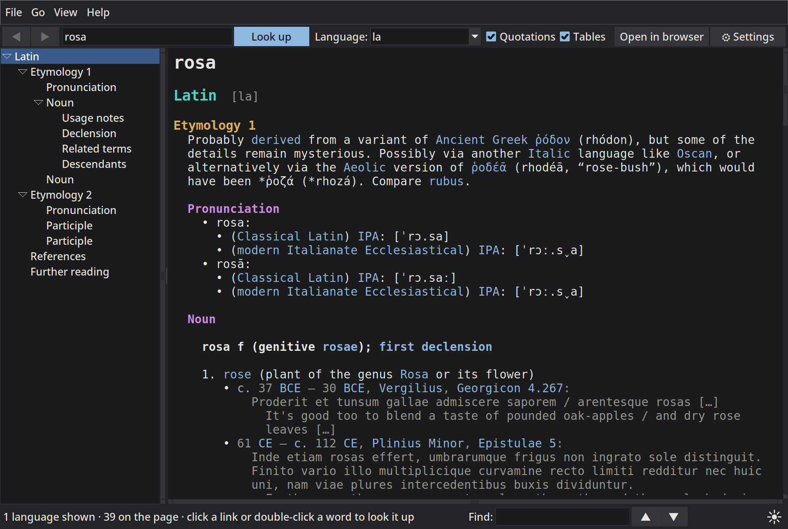
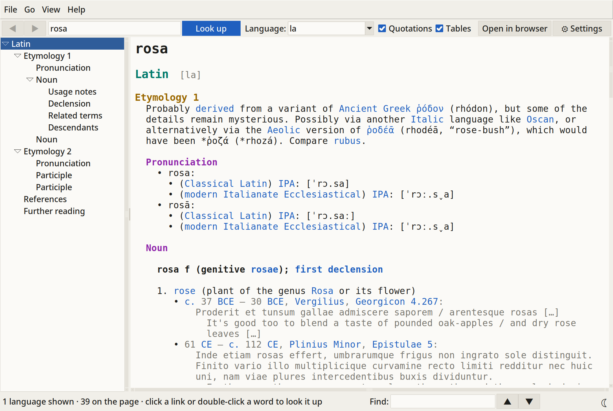
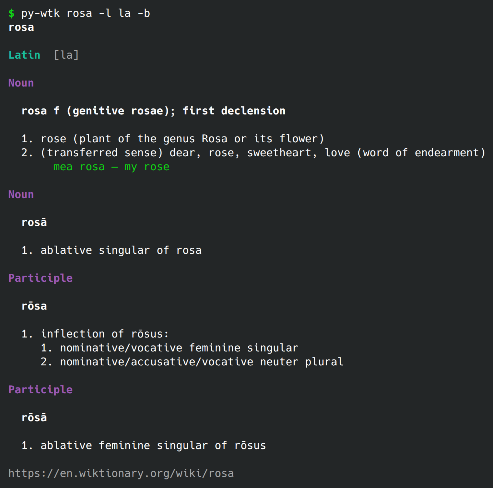
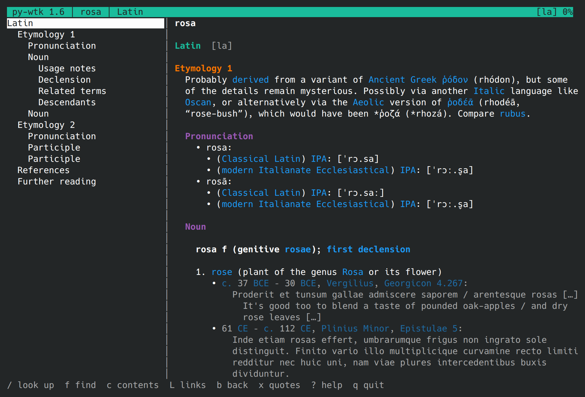

# py-wtk

*[Leer en español](README.es.md)*

py-wtk is a small program for consult the [English Wiktionary](https://en.wiktionary.org)
without open the web browser. It comes in three flavours, and all of them use the same code
inside:

| Program      | What it is                                                   |
|--------------|--------------------------------------------------------------|
| `py-wtk`     | command-line tool, it prints the entry in the terminal       |
| `py-wtk-tui` | full-screen terminal interface (curses)                      |
| `py-wtk-gui` | desktop window (Tkinter)                                     |

It shows the complete entry, not only the definitions: etymology, pronunciation,
definitions with examples and quotations, usage notes, inflection tables (declensions,
conjugations), synonyms, derived and related terms, descendants, translations, references
and further reading. By default it shows **all the languages** of the page, but you can
choose only the ones you need, for example only Latin, or Latin and Spanish.

I am Nicolás Vaughan (<nivaca@fastmail.com> and <n.vaughan@uniandes.edu.co>), and I wrote
it in 2026.

[Nicolas Vaughan](https://artehum.uniandes.edu.co/profesores/nicolas-vaughan/) is Associate
Professor of Literature at the School of Arts and Humanities of the Universidad de los
Andes, Bogotá, Colombia.

## Screenshots

Here is the same word, *rosa* (only its Latin entry, with `-l la`), in the window
(`py-wtk-gui`, here in dark mode):



the window in light mode:



in the command line (`py-wtk`, here brief, with `-b`):



and in the terminal, in full screen (`py-wtk-tui`):



These four pictures are made by `python3 tools/screenshots.py`, which runs each program
out of sight, with settings of its own, and writes them in `docs/img/` (see
[For developers](#for-developers)).

## Requirements

- Python 3.11 or newer (it uses `tomllib` for read the settings). It was tested with
  Python 3.11 and 3.15.
- Nothing more for `py-wtk` and `py-wtk-tui`: only the standard library is used, there are
  no packages to install with pip.
- For `py-wtk-gui` you need Tkinter. In many Linux distributions it comes in a separate
  package: `python3-tkinter` in Fedora, `python3-tk` in Debian and Ubuntu.
- Of course, a connection to Internet.

## Installation

**The easy way, in Linux:** download the AppImage of the last release
(`py-wtk-v.VERSION-x86_64.AppImage`), make it executable and run it. It has its own Python
inside, so you don't need to install nothing:

```sh
chmod +x py-wtk-v.*-x86_64.AppImage
./py-wtk-v.*-x86_64.AppImage            # the window
./py-wtk-v.*-x86_64.AppImage cli rosa   # the command line (also: tui; help lists them)
```

A link to the AppImage named `py-wtk`, `py-wtk-tui` or `py-wtk-gui` starts that program.

**With your own Python** (any system): download the zip of the last release
(`py-wtk-v.VERSION.zip`), or clone the repository, put the folder wherever you want, and
make links to the three launchers in a directory that is in your `PATH`:

```sh
ln -s ~/py-wtk/py-wtk      ~/.local/bin/
ln -s ~/py-wtk/py-wtk-tui  ~/.local/bin/
ln -s ~/py-wtk/py-wtk-gui  ~/.local/bin/
```

The launchers find the `pywtk` package next to them, also when you call them by a link.
Is also possible to run the command-line tool with `python3 -m pywtk WORD` from inside the
folder.

**In the applications menu:** `py-wtk-install.py` adds the window, the terminal version and
the command line (`py-wtk (GUI)`, `py-wtk (TUI)` and `py-wtk (CLI)`, this last one with
`-i`, that asks for one word after another), with their icon, to the applications menu in
Linux, the Start menu in Windows, or `~/Applications` in macOS. It writes only in your own
folders, so no administrator rights are needed:

```sh
python3 py-wtk-install.py               # add them
python3 py-wtk-install.py --only-gui    # add only the window
python3 py-wtk-install.py --uninstall   # remove them
```

With `--only-gui`, if an earlier run added the terminal version and the command line, their
entries are removed.

The entries start the program from its folder, so if you move the folder, run it again.

## Command line: `py-wtk`

```sh
py-wtk rosa                       # full entry, all languages
py-wtk rosa -l la                 # only Latin
py-wtk rosa -l Latin              # the same, with the name of the language
py-wtk rosa -l la,es,it           # several languages
py-wtk rosa -b                    # brief: only the definitions
py-wtk rosa -l la -o etymology    # only some sections
py-wtk house -x translations,quotations,tables   # hide some sections
py-wtk hablar -l es -o conjugation
py-wtk ice cream                  # expressions of several words, no quotes needed
py-wtk -s recei                   # search page titles
py-wtk house --json               # structured JSON, for use in other programs
py-wtk -i                         # asks for one word after another (also: rosa -l la)
```

Options:

| Option                  | Meaning                                                          |
|----------------------------|------------------------------------------------------------------|
| `-l`, `--lang`          | languages, by code (`la`, `grc`) or name (`Latin`); `all` is the default |
| `-o`, `--only`          | show only these sections (separated by commas)                   |
| `-x`, `--exclude`       | hide these sections; `quotations` and `tables` are also accepted |
| `-b`, `--brief`         | only the definitions, without etymology, quotations, tables…     |
| `-s`, `--search`        | search titles of pages instead of show an entry                  |
| `-F`, `--full`          | full entry, also when the setting `cli.brief` is on              |
| `-n`, `--limit`         | how many results for `--search` (default 10)                     |
| `-i`, `--interactive`   | then ask for more words, one by line, with options if you want; `Ctrl-D` ends |
| `--json`                | output in JSON                                                   |
| `--no-color`            | without colours (also respected: the `NO_COLOR` variable)        |
| `--no-pager`            | don't use `less` for the long entries                            |
| `--refresh`             | download the page again, without use the disk cache              |

The options for the settings (see [Settings](#settings) below): `--settings`,
`--configure`, `--set`, `--unset`, `--edit-settings` and `--clear-cache`.

The names of sections are compared without care of capital letters and numbers, so
`etymology` matches "Etymology 1" and "Etymology 2". When the word don't exist, the program
proposes similar words. When the entry is longer than the screen, it is opened in `less`
(or in your `$PAGER`).

The links of the entry are hyperlinks: in the terminals that know them (most of the modern
ones, and `less`) you can click them, usually with `Ctrl` pressed. Other pagers (such as
`most` or `more`) can't show them, so in those the entry is shown without links. If your
terminal shows them as stray characters, turn off the setting `cli.links`.

The exit code is `0` if all is fine, `1` if nothing was found and `2` for network errors.

## Terminal interface: `py-wtk-tui`

```sh
py-wtk-tui            # starts with an empty screen; press / for search
py-wtk-tui rosa       # opens directly the word
py-wtk-tui rosa -l la
```

At the left there is a table of contents with the languages and the sections, at the right
the entry. Main keys (press `?` inside the program for the complete list):

| Key                  | Action                                          |
|----------------------|-------------------------------------------------|
| `/`                  | look up a word (in the prompt, `Tab` gives suggestions) |
| `j` `k`, arrows      | scroll                                          |
| `Space`, `PgDn` `PgUp` | scroll a page                                 |
| `[` `]`              | previous / next section                         |
| `{` `}`              | previous / next language                        |
| `c` or `Tab`         | go to the contents pane                         |
| `t`                  | show / hide the contents pane                   |
| `f`, `n` `N`         | find in the page, next / previous match         |
| `l`                  | change the languages                            |
| `b` `B`              | back / forward in the history                   |
| `L`                  | list of the links on the screen, for open one   |
| `x` `T`              | show / hide quotations, tables                  |
| `o`                  | open the page in the web browser                |
| `S`                  | settings                                        |
| `q`                  | quit                                            |

The mouse wheel works also, and you can click in the contents and on the links (in blue).
The links to other entries open in the program, at the top of the entry; the others
(Wikipedia, the appendices of Wiktionary, other dictionaries…) in the web browser.

## Desktop window: `py-wtk-gui`

```sh
py-wtk-gui
py-wtk-gui rosa -l la
py-wtk-gui rosa --dark --size 13       # dark and bigger only this time (--light also exists)
```

- Search box with suggestions while you write (arrow down to choose one).
- **Click on a link for open it.** The links to other entries open in the window, at the
  top of the entry and with the languages of the filter; the others (Wikipedia, the
  appendices of Wiktionary, other dictionaries…) in the web browser. The status line
  says where a link goes.
- **Double-click on any word of the entry for look it up.** The right button gives a menu
  with "Look up", "Copy" and "Select all".
- Contents tree: click on a section for go there; it follows you when you scroll.
- Language selector with the languages of the actual page; you can also write `en,la`.
- Checkboxes for show or hide quotations and tables.
- Find in the page (`Ctrl+F`, then `F3` / `Shift+F3`), with all the matches highlighted.
- Back and forward (`Alt+←`, `Alt+→`), reload (`F5`), open in the browser.
- Light and dark mode for all the window: the moon ☾ at the bottom right makes it dark,
  the sun ☀ makes it light again (also *View → Dark mode*). The choice is remembered.
- Bigger and smaller text with `Ctrl++` and `Ctrl+-` (all the text of the window, not only
  the entry), and `Ctrl+0` for the usual size.
- Settings window (`Ctrl+,`, the "⚙ Settings" button or *File → Settings…*).
- The pages are loaded in background, so the window don't freeze.

The text uses a monospace font, because in this way the tables of declensions and
conjugations stay well aligned.

## Settings

The three programs share one settings file, `config.toml`, in the usual settings folder of
the system:

| System  | File                                                   |
|---------|--------------------------------------------------------|
| Linux   | `~/.config/py-wtk/config.toml` (or `$XDG_CONFIG_HOME/py-wtk/`) |
| macOS   | `~/Library/Application Support/py-wtk/config.toml`     |
| Windows | `%APPDATA%\py-wtk\config.toml`                         |

With the variable `PY_WTK_CONFIG` you can name another folder. The file is
[TOML](https://toml.io), divided in sections: `[general]`, `[cli]`, `[tui]`, `[gui]`,
`[fonts]` and `[appearance]`. Each setting can be left out, and then it has its usual
value; in the file, the ones left out appear commented, with their usual value, and each
setting has a comment that explains it. So you can also edit it by hand. If some value is
not valid, the program tells you and uses the usual one.

The programs write in the file only the settings that you change, over the file as it is
in that moment: if the window and the terminal interface are open at the same time, one
don't undo the changes of the other. To restore the usual value of a setting removes it
from the file. When the file is written again, your own comments are not kept.

(Earlier versions were called **py-wkt**. If you used them, its settings pass one time to
the new folder: the `config.toml` of `~/.config/py-wkt/`, or its older `settings.ini`;
the old file is renamed `*.old`. The variable `PY_WKT_CONFIG` is still read.)

What you can change:

| Setting                         | Default | What it does                                     |
|---------------------------------|---------|--------------------------------------------------|
| `general.languages`             | `all`   | languages shown when you don't give `-l`         |
| `general.preferred_languages`   | (empty) | these languages go first, e.g. `la, en`          |
| `general.show_quotations`       | `true`  | the dated quotations under the definitions       |
| `general.show_tables`           | `true`  | declension and conjugation tables                |
| `general.show_translations`     | `true`  | the translations (in big entries they are long)  |
| `general.hidden_sections`       | (empty) | sections never shown, e.g. `anagrams, references`|
| `general.search_results`        | `10`    | number of results and suggestions                |
| `general.max_width`             | `110`   | maximum width of the text, in characters         |
| `general.cache_days`            | `1`     | days that the downloaded pages stay on disk (0 = no cache) |
| `cli.color`                     | `auto`  | `auto`, `always` or `never`                      |
| `cli.pager`                     | `auto`  | `auto`, `always` or `never`                      |
| `cli.pager_command`             | (empty) | pager to use instead of `$PAGER` / `less`        |
| `cli.links`                     | `true`  | clickable links, in the terminals that can       |
| `cli.brief`                     | `false` | brief mode always (then `-F` gives the full entry) |
| `tui.show_contents`             | `true`  | the contents pane                                |
| `tui.contents_width`            | `30`    | its width, in columns                            |
| `tui.colors`                    | `true`  | colours in the terminal interface                |
| `tui.mouse`                     | `true`  | use of the mouse; off for select text as normal  |
| `tui.wheel_lines`               | `3`     | lines for each step of the wheel                 |
| `gui.show_contents`             | `true`  | the contents pane                                |
| `gui.contents_width`            | `250`   | its width, in pixels                             |
| `gui.double_click_lookup`       | `true`  | double-click on a word looks it up               |
| `gui.links`                     | `true`  | the links of the entry can be clicked            |
| `gui.live_suggestions`          | `true`  | suggestions while you write                      |
| `gui.remember_window`           | `true`  | open the window with the last size               |
| `fonts.text_family`             | (empty) | font of the entries (better fixed-width); empty = the usual one |
| `fonts.text_size`               | `11`    | size of the entries                              |
| `fonts.ui_family`               | (empty) | font of the rest of the window; empty = the system's |
| `fonts.ui_size`                 | `0`     | its size; `0` = the system's                     |
| `appearance.dark_mode`          | `false` | dark window (left out of the file: light)        |

Ways for change them:

- **Command line:**
  ```sh
  py-wtk --settings                         # list all, with the actual values
  py-wtk --configure                        # small interactive menu
  py-wtk --set general.languages=la,en      # change one (repeatable)
  py-wtk --set preferred_languages=la       # the section can be omitted if not ambiguous
  py-wtk --unset general.languages          # back to the default
  py-wtk --edit-settings                    # open the file in $VISUAL / $EDITOR
  py-wtk --clear-cache                      # delete the pages kept on disk
  ```
- **Terminal interface:** press `S`. Enter changes the selected setting (true/false and
  the choices change directly, the others ask for the value), `d` puts the default, `Esc`
  closes. The changes are saved in the moment.
- **Window:** *File → Settings…* (`Ctrl+,`, or the "⚙ Settings" button). The tabs are
  Appearance (dark mode and the fonts, with a list of the fixed-width fonts that are
  installed and a preview), Window, General (with a button for clear the disk cache),
  Terminal UI and Command line.

Some things are remembered automatically: in the TUI and the GUI, to show or hide the
quotations, the tables or the contents pane is saved; in the GUI also the dark mode, the
size of the text (only what is different of the usual is written in `[fonts]`), the width
of the contents pane and the size of the window.

## How it works

The program downloads the page in HTML from the Wiktionary REST API
(`/api/rest_v1/page/html/…`) and converts it to text. Only the Python standard library is
used for this (`urllib`, `html.parser`, `textwrap`, `curses`, `tkinter`). The big entries,
like *house*, have the translations in a separate page (`house/translations`); py-wtk
downloads it also and shows the translations in their place.

The downloaded pages are kept compressed in the cache folder of the system
(`~/.cache/py-wtk` in Linux, `~/Library/Caches/py-wtk` in macOS, `%LOCALAPPDATA%\py-wtk\cache`
in Windows) during one day (setting
`general.cache_days`), so to look again the same word is instantaneous and don't make new
requests to Wiktionary. In the TUI and the GUI, *reload* (`r`, `F5`) downloads the page
again; in the command line, `--refresh`.

Organisation of the code:

```
py-wtk, py-wtk-tui, py-wtk-gui   small launchers
pywtk/
  api.py      download of pages, search, cache
  dom.py      HTML parsing
  text.py     cleaning of the text, width in the terminal, colours
  entry.py    languages, sections, filters and options
  config.py   reading and writing of config.toml
  settings.py the settings: what they are, their values (shared by the three programs)
  gui_theme.py  light and dark look of the window
  gui_fonts.py  fonts of the window
  render.py   conversion of an entry to text (shared by the three programs), JSON
  common.py   what the three programs share: options, messages, history, links
  cli.py      py-wtk
  tui.py      py-wtk-tui
  gui.py      py-wtk-gui
  version.py  name, version, the commit it was made from, the Python needed
icons/        the icons (Linux, macOS, Windows)
```

## For developers

Five scripts, in `tools/`, make the bundles, publish the releases, take the screenshots and
make the icons. They are not in the bundles.

| Script                     | What it does                                                   |
|----------------------------|----------------------------------------------------------------|
| `tools/bundle-zip.py`      | makes `dist/py-wtk-v.VERSION.zip`: the program, the icons and the documents, without hidden files, `__pycache__` nor the tools, with a `COMMIT` file (shown by `--version` and *About*). `--list` only lists the files. |
| `tools/bundle-appimage.py` | makes `dist/py-wtk-v.VERSION-x86_64.AppImage`, with a Python of its own (from [python-appimage](https://github.com/niess/python-appimage)) and the program as in the zip. The first time it downloads that Python and [appimagetool](https://github.com/AppImage/appimagetool) into `~/.cache/py-wtk-build`; `--python` and `--appimagetool` give them instead. |
| `tools/release.py`         | publishes the tag `vVERSION` on GitHub (`gh`) and Codeberg (`tea`) with the zip and the AppImage: it makes them, tags, pushes and makes or updates the releases. It shows the commands and asks before; `--dry-run` only shows them. See `--help`. |
| `tools/screenshots.py`     | takes the screenshots of the three programs into `docs/img/` (the window light and dark), with settings and cache of its own, so yours are not touched. It needs tmux, ImageMagick, Chrome or Chromium, and Xvfb or a display. |
| `tools/icons.py`           | makes all the icons again from `icons/py-wtk.svg`: the PNGs, the Linux, macOS and Windows icons. Each size is drawn by Inkscape (also as a Flatpak) from the SVG; the `.icns` and the `.ico` are put together with Pillow. `--dry-run` only shows how Inkscape would be run. |

The version is in `pywtk/__init__.py`.

## Notes

- Wiktionary limits the number of requests. If you make many in short time you can receive
  a "Too Many Requests" error; the program waits and retries some times automatically, but
  if the error continues, wait one minute. The disk cache helps to avoid this.
- The content of the entries comes from Wiktionary and its authors, under the licence
  [CC BY-SA 4.0](https://creativecommons.org/licenses/by-sa/4.0/). py-wtk only shows it;
  please respect this licence if you copy texts from the entries.
- py-wtk is not an official project of Wiktionary or of the Wikimedia Foundation.

## Licence

Copyright © 2026 Nicolas Vaughan <nivaca@fastmail.com>

This program is free software: you can redistribute it and/or modify it under the terms of
the GNU General Public License as published by the Free Software Foundation, either version
3 of the License, or (at your option) any later version.

This program is distributed in the hope that it will be useful, but WITHOUT ANY WARRANTY;
without even the implied warranty of MERCHANTABILITY or FITNESS FOR A PARTICULAR PURPOSE.
See the [LICENSE](LICENSE) file for more details.
